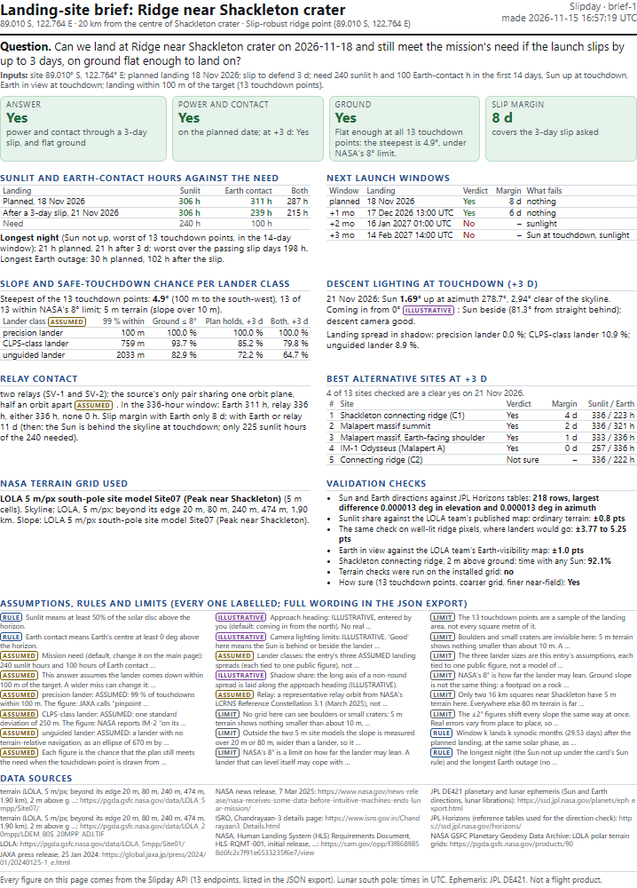

# Add-on: review-board brief (`brief-1`)

One printable page that answers "can we land here on this date and survive this slip?" for a review board, so a
planner no longer stitches seven views together by hand. Every number on it comes from the entry's existing
endpoints; the add-on adds no computation.

Files (all new):

- back end `slipday/addons/brief.py`, router `router`
- page `static/brief.html` (standalone; works from a link)
- container module `static/addons/brief.js` (one container `

`)
- tests `tests/addons/test_brief.py`, browser check `tests/addons/brief_check.mjs`, and `tests/addons/brief_app.py`
  (the entry's app with this router included, used by both until `api.py` registers it)
- screenshots `screenshots/brief_opening.png` (screen), `screenshots/brief_opening_print.png` (print layout),
  `screenshots/brief_opening.pdf` (A4, as saved from the print dialog)

**To register:** add `"addons.brief"` to the optional-router loop in `slipday/api.py`. Not done here, as instructed.

## Endpoint

`GET /api/addons/brief?site=..&date=..&slip=..`

| Parameter | Default | Meaning |
|---|---|---|
| `site` | `robust_pick` | site id from `/api/sites` (or `lat` + `lon` + optional `name` instead) |
| `date` | `2026-11-18` | planned landing, date or full UTC time |
| `slip` | `3` | launch slip to defend, days (0 to 120) |
| `alternatives` | `true` | `false` skips the alternatives check (the slow part) |

It calls these endpoints in-process through the app itself (a `TestClient` on `slipday.api.app`), so the brief
holds exactly what those endpoints answer: `POST /api/mission`, `/api/windows`, `/api/survival`,
`/api/lander-classes` (default need, 100 m scatter, followed for max(15, slip) days); `GET /api/addons/safety/site`,
`/api/addons/safetouch/site`, `/api/addons/planner/lighting`, `/api/addons/planner/joint`,
`/api/addons/planner/alternatives` (at landing + slip), `/api/addons/relay/window`, `/api/validation`,
`/api/terrain/validation`, `/api/health`. A part that fails or does not apply (for example no 5 m terrain) carries
its endpoint's own reason instead of failing the brief. Unknown site: 404. Unreadable date or slip out of range: 422.
Answers are cached (16 entries).

JSON fields: `question`, `answer{overall, word}`, `inputs{site, landing_utc, slip_days, need, window_days, scatter_m,
rules}`, `verdict{power_and_contact{verdict, at_slip, sentences, how_sure, finer_grid}, ground{verdict, headline}}`,
`slip_margin{days, asked_days, holds}`, `windows{rows[{landing_utc, verdict, slip_margin_days, fails_on, reasons}]}`,
`hours{need_*, planned, at_slip, by_day}`, `longest_night`, `slope{steepest, classes[{label, within_99_pct_m,
flat_8deg_pct, plan_holds_at_slip_pct, both_at_slip_pct}]}`, `lighting`, `relay`, `alternatives{rows (top 5)}`,
`terrain`, `checks`, `assumptions[{label: assumed/illustrative/limit/rule, text, from}]`, `sources[{label, url}]`,
`endpoints`.

"Answer" is Yes only when power and contact is a clear yes with a slip margin at least the slip asked, and the ground
is flat enough at all 13 touchdown points (NASA's 8°). It is No when the planned date or the slipped date is a no, or
the ground is too steep; otherwise Not sure.

## Page

`/static/brief.html?site=robust_pick&date=2026-11-18&slip=3` (also `lat`, `lon` in place of `site`). The bar at the
top (hidden in print) changes the inputs; "Download brief" opens the print dialog (choose "Save as PDF"); "JSON"
downloads the same content the page shows. Light colours only, black on white; links print with their URL.
Print CSS keeps it to **one page on both A4 and Letter** for the opening example (measured with headless Chrome's
PDF output). In print the assumptions are cut to about 100 characters each, the terrain file list is left out and
the summary sentences are hidden; the full wording is in the JSON export and on screen.

## Container

Put `

` in the **"What to do"** step (beside the alternatives), and add
`` after `/static/app.js`. It draws a "Make a review-board brief"
button and a "slip to defend" box; the button opens `brief.html` in a new tab for the site and landing of the page's
latest `/api/mission` request (request read, answer cloned, nothing changed). Until then it points at the opening
example. Styled with the page's `--text --muted --line --surface --accent`, with fallbacks.

## Opening example (measured 15 Nov 2026, robust_pick, 18 Nov 2026, slip 3 days)

Answer **Yes**: power and contact Yes (also Yes at +3 d), ground Yes (steepest 4.9° of 13 points), slip margin
8 days. 306 sunlit h / 311 Earth h planned; 306 / 239 h after 3 days (need 240 / 100). Longest night 21 h. Next
windows: 17 Dec 2026 Yes (6 d), 16 Jan 2027 No (sunlight), 14 Feb 2027 No (Sun at touchdown, sunlight). Lander classes
(ground ≤ 8° / plan holds +3 d / both): precision 100 / 100 / 100 %, CLPS-class 93.7 / 85.2 / 79.8 %, unguided
82.9 / 72.2 / 64.7 %. Sun 1.69° up at touchdown, beside a north approach. Relay pair: Earth or relay margin 11 d.
4 of 13 alternatives a clear yes on 21 Nov; top is C1 (4 d). Terrain: LOLA 5 m site model Site07.

## Tests

- `tests/addons/test_brief.py`: every section present; slip margin, verdict and hours equal `/api/mission`; windows,
  longest night, lighting and safe-touchdown figures equal their endpoints; assumptions all labelled, sources all
  links; a slip past the margin is not covered and the answer is not Yes; lat/lon sites; 404/422 errors; static files
  served. It loads the real LOLA stack as `test_planner.py` does. Run: **8 passed** in 3 min 16 s (cold skyline
  cache; most of it is the alternatives check). The full suite was not run.
- `node tests/addons/brief_check.mjs` (starts its own server on port 8481 and stops it by PID): the brief renders
  with **no console errors**, its slip margin and sunlit hours equal an independent `/api/mission` call, all ten
  section headings are present, no sideways scroll at 390 px, A4 and Letter PDFs are 1 page each, and the
  container's button links to `brief.html` for the opening example. Result: all passed.

## What is not done

- `api.py` does not register the router yet (orchestrator's step), and the container is not placed in `index.html`.
- The brief uses the default need and rules (240 sunlit h, 100 Earth h, 14 days, 100 m, half the Sun's disc); it does
  not yet take the page's own need or rule settings.
- The descent-lighting approach heading is the planner add-on's default (from the north), labelled illustrative.
- The "JSON" button needs the browser to allow downloads from the page; the endpoint gives the same JSON directly.
- One page is checked for the opening example only; a site with long reasons in every section may run to a second page.
